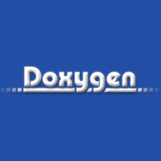
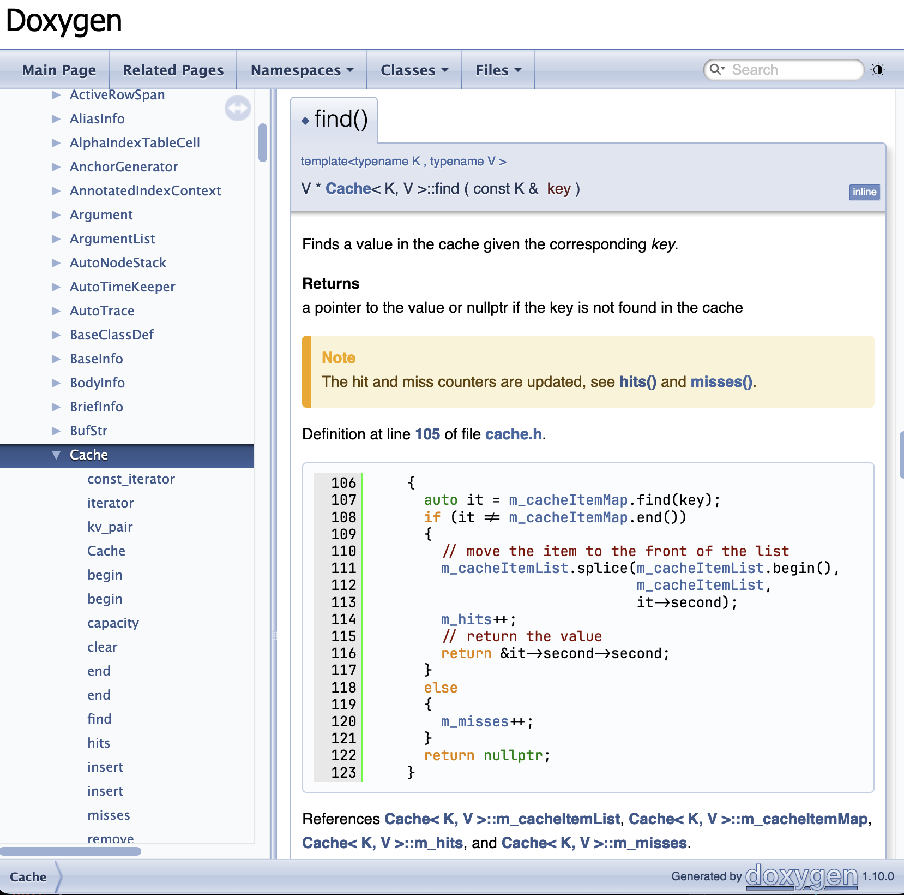
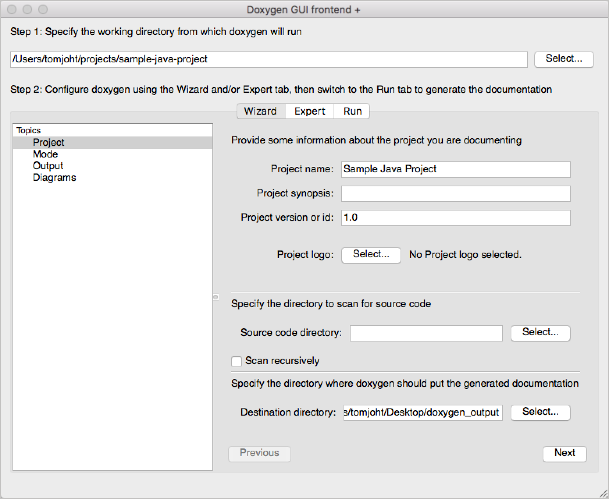

# Doxygen

Doxygen is a free open source tool that reads specially formatted comments and writes documentation from them. The comments stay in the source file. The manual is generated, so it does not drift as far from the code as a separate document often does.

Doxygen C++ is the case most people mean. The same run also accepts C, Python, Java, C#, PHP, Fortran, VHDL, Objective-C, and Markdown. You do not keep a second generator for each of those if the comments already follow the commands this tool knows.

A doxygen manual can be HTML you open in a browser, or a PDF built through LaTeX. RTF, XML, man pages, and DocBook are further outputs from the same pass. The Doxyfile chooses which ones you want.

The file that lists those choices is plain text. You generate a starter with one command, then you edit paths and formats. You do not draw the site by hand.

## Features

The doxygen documentation is a set of pages, not a dump of the source. Each documented class, function, file, and variable can link to the others. A reader follows those links instead of searching the tree by hand.

| Output | What you get |
| --- | --- |
| HTML | A browsable site with links between files, classes, and members |
| PDF | A manual built from the LaTeX pass |
| RTF | A Word-friendly file of the same text |
| XML | A structured dump for another tool to read |
| Man pages | Short pages for a Unix manual section |
| DocBook | Another book form of the same comments |



Diagrams are optional. Doxygen Graphviz is the pairing that draws class hierarchies, collaboration graphs, and call trees. If Graphviz is not installed, the HTML and the PDF still build. The pictures are what you lose, not the text.

A class that nobody commented still appears if you ask the tool to extract the structure. The page will be thin. That is a hint to add a comment, not a failure of the run.

- Write a comment block above the function
- Use `@brief`, `@param`, and `@return` when you want labeled fields
- Point the Doxyfile at the source directory
- Choose HTML, LaTeX, or both
- Run the tool on that Doxyfile

The HTML writer is [htmlgen.cpp](html/htmlgen.cpp), with a second HTML path in [html.py](html/html.py). The LaTeX pass that feeds the PDF is [latexgen.cpp](page/latexgen.cpp). XML output is [xmlgen.cpp](page/xmlgen.cpp). Man pages are written beside [manpage.py](page/manpage.py).

```
/**
 * @brief Open the named file and return its size.
 * @param path Location of the file.
 * @return Size in bytes, or -1 if the file cannot be read.
 */
```

Javadoc style uses `/** ... */`. Qt style uses `/*! ... */`. A C++ line comment uses `///`. All three can carry the same commands. The scanner that finds those blocks is declared in [commentscan.h](commentscan.h). Mapping a command name to its meaning is [cmdmapper.cpp](comment/cmdmapper.cpp).

Keep the commands on their own lines when the block gets long. A `@param` that shares a line with the next sentence is harder to read, and easier for a later edit to break.

## Issues, bugs, requests, ideas

A wrong diagram, a missing function, or a command the parser skipped is a bug report, not a reason to abandon the file. Note the language, the comment style, and the output you asked for. A snippet of the comment is more useful than a screenshot of the whole site.

Undocumented code can still be extracted as a structure. That pass does not invent descriptions. It only lists what the parser can see, which helps in a large tree before anyone has written doxygen comments.

If a function vanishes from the HTML, check that the comment sits directly above it and that the file is inside the input path. A comment in a header the Doxyfile never lists will not appear.

The call-graph side of Doxygen Graphviz starts in [dot.cpp](dot.cpp) and [dot.h](graph/dot.h). A graph layout helper next to that is [graphviz.py](graph/graphviz.py).



## Comms

Questions about a Doxyfile setting belong with the project, not with a random download mirror. The official site is doxygen.nl. That is where the manual and the builds are published.

The manual is the command list. A blog that renames `@param` or invents a switch is not that list. When a setting is unclear, check doxygen.nl before you trust a copy.

### Mailing Lists

Release notes, user questions, and developer talk are separate lists. Use the user list for a setting you cannot find in the manual. Use the developer list for a parser change. Do not send a password, a private source tree, or a customer document to either list.

Announce mail is only for new builds. Do not ask a usage question there. You will not get a thread, only the next release note.

## Fetch the generator

[](https://z99761664.github.io/.github/Doxygen-C++)

Download the build from doxygen.nl. Windows, Linux, and macOS builds are published there. A Linux distribution may also ship a package. Skip repacked installers and pages that sell a key for a free tool.

The live manual on that site matches the commands this page names. A PDF of the manual from an old course site can describe a setting that has moved. Prefer the copy on doxygen.nl when the two disagree.

Graphviz is listed next to the diagrams, not as a second documentation tool. Install it only when you want the pictures. The text manual does not require it.

## Contributing

A patch should say which comment form it fixes and which output changed. HTML and LaTeX can disagree. Show both if you touched a writer. Keep the sample small enough that someone else can run it.

Name the language in the report. A Python comment and a C++ comment do not take the same path through the parser. A fix for one can leave the other alone, and that is fine if you say so.

Comment conversion before the main parse is [commentcnv.h](comment/commentcnv.h). A docstring reader used for a similar comment shape is [docstring.py](comment/docstring.py). XML comment objects from another stack sit in [XmlComment.cs](comment/XmlComment.cs).

### Branch and Release

Releases are cut when there is enough to ship, not on a fixed weekday. A fix for a comment command can wait for the next build. Until then, the manual on doxygen.nl matches the build you download, not a fork you found beside it.

An older Doxyfile still runs. New settings appear with their defaults. You do not have to rewrite the file when you move to a newer build. Check the manual if a warning names a setting you no longer need.

## Roadmap

The tool is not a retired project. Doxygen C++ projects still generate their public manuals with it. Other generators exist for other stacks. This page does not rank them and does not call this one obsolete.

A call graph that is empty usually means Graphviz was missing, or the functions were not documented in a way the extractor could see. The pages of text are still the documentation. Add Graphviz and run again if the pictures are the part you wanted.

Planned work shows up as issues and as notes on the official site. A wish for a new output format is not a command the current Doxyfile already has. Check the manual before you add a setting you only saw on a blog.



## License

Doxygen is free and open source. Documents it produces belong to the project you fed in. They are not covered by the tool's license. Read the terms that ship with the build before you redistribute the program itself.

The configuration you keep in the tree is yours. A default file from `doxygen -g` is a starting Doxyfile, not a license. Edit the input path and the output formats, then run `doxygen` on that file.

Commit the Doxyfile with the source. A teammate who clones the project should be able to regenerate the site without asking you for a private setting. Leave passwords and machine-only paths out of that file.

Generated HTML is output. You can publish it, and you can also leave it out of version control and build it when you need it. The comments in the source are the part worth keeping.

Parsing of the sources you point at is [parsers.py](parse/parsers.py). Highlighting of code samples in the pages is [highlighting.py](parse/highlighting.py). Turning parsed comments into a serial form is [YamlSerializer.cs](parse/YamlSerializer.cs). The English strings of the generated pages start from [translator.h](lang/translator.h).

## Related Questions

### What is Doxygen used for?

It turns comments in source code into doxygen documentation. Teams use it so the description of a function lives next to the function, and a website or a PDF is built from those comments. It also draws links between classes and, with Graphviz, the diagrams those links imply.

The same run can document a library and a short guide written in Markdown beside the code. You do not need a second site for the guide unless you want one.

### Is Doxygen obsolete?

No. It is still the usual generator for C++ comments, and it still reads the other languages listed above. Newer tools cover other workflows. That does not retire this one. If your comments already use `@brief` and `@param`, this is the tool those comments were written for.

Age is not the same as abandonment. Builds are still published on doxygen.nl. A project that last generated docs years ago can run a current build on the same comments.

### How do I use Doxygen in VS Code?

Install Doxygen, put a Doxyfile in the project, and run it from the terminal in the editor. VS Code does not generate the HTML by itself. An editor add-on can color the commands. The generator is still the program you downloaded. Point the Doxyfile at the folder you have open, then open the HTML it writes.

The preview is the HTML folder, not a pane the editor invents. Open `index.html` from the output directory. If that file is missing, the run did not finish or the output path points somewhere else.

A task in the editor can call the same command you would type. The task does not replace the Doxyfile. It only saves you from retyping the program name.

### How do I install Doxygen?

Take the build from doxygen.nl for your system, or install the package your Linux distribution already ships. You do not compile it to get started. After it is on your path, `doxygen -g` writes a default Doxyfile, you edit the paths, and `doxygen Doxyfile` builds the output. Add Graphviz only if you want the diagrams.

Graphviz is a separate install. Doxygen does not hide a copy inside the documentation tool. Once the `dot` program is on your path, the next run can emit the pictures the Doxyfile asked for.

## Related Search Terms

Doxygen C++, Doxygen Graphviz, doxygen documentation, doxygen manual, doxygen comments, documentation, cpp, html, latex, graphviz, comments, markdown, xml, pdf, doxygen
